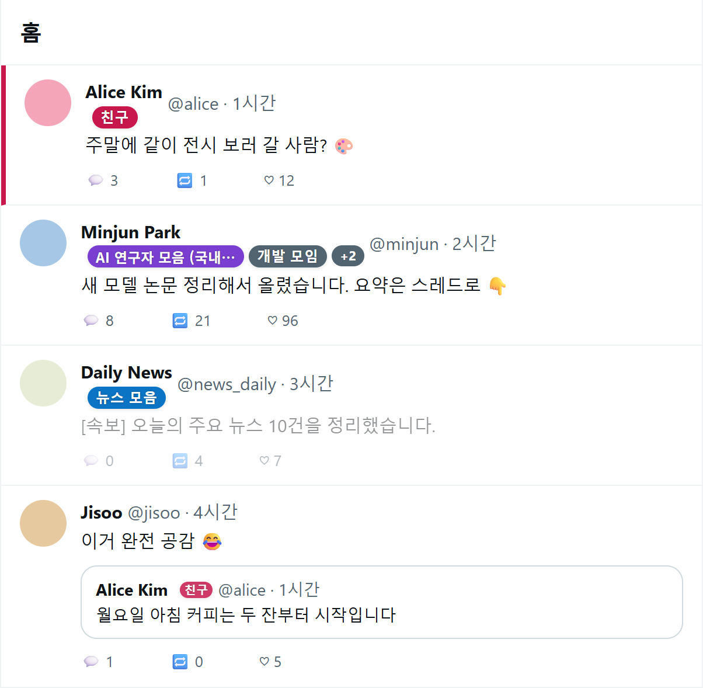
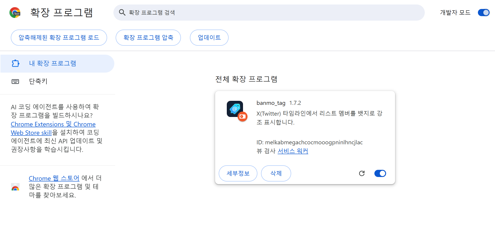
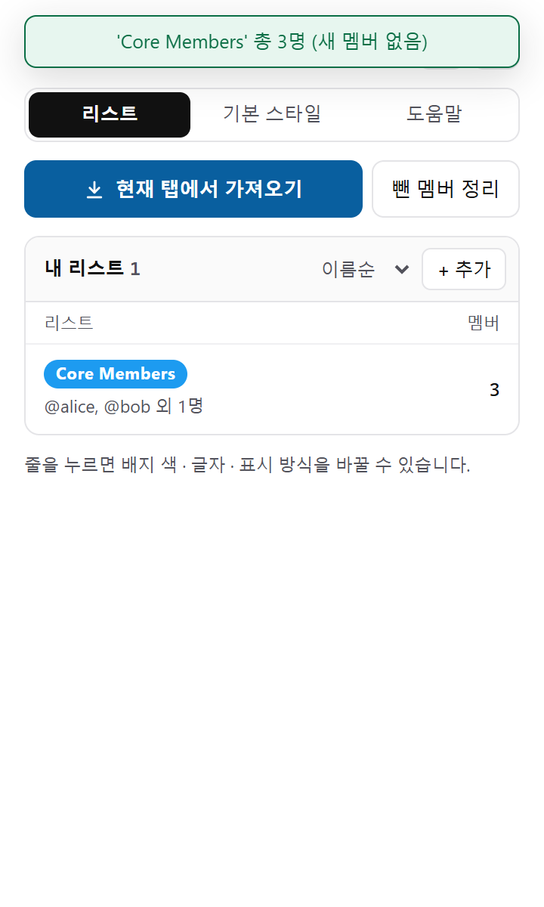
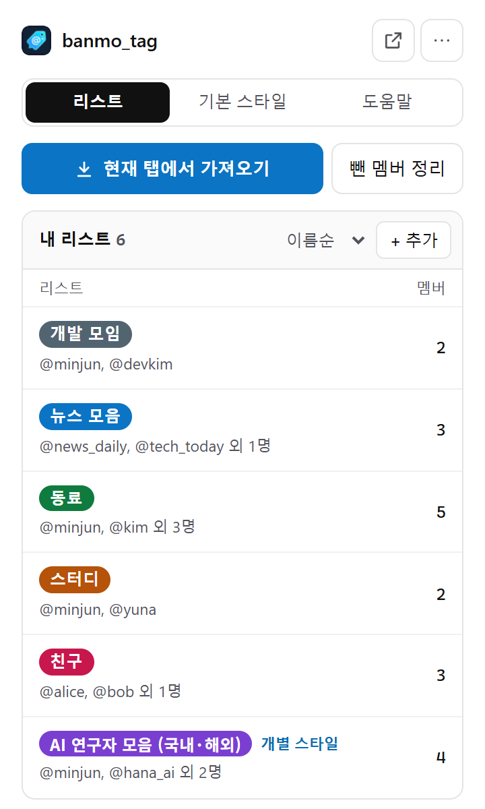
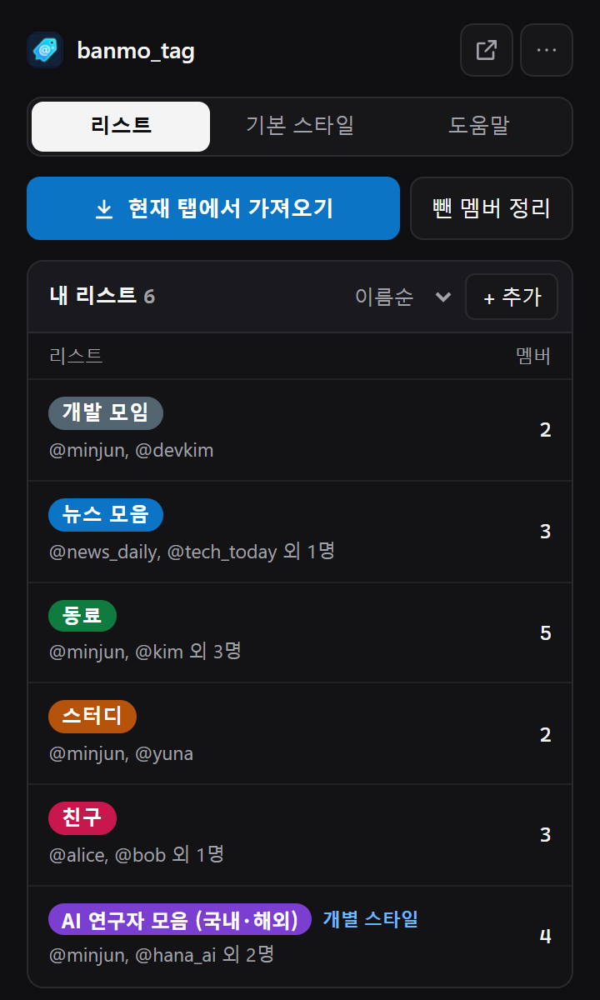

# banmo_tag (Chrome · Firefox Extension)

banmo_tag는 X(Twitter) 타임라인에서 **내가 정한 리스트의 멤버를 한눈에 알아볼 수 있게** 해 주는 브라우저 확장 프로그램입니다. 리스트 멤버가 쓴 트윗의 이름 옆에 리스트 배지를 붙이고, 리스트마다 트윗을 강조하거나 흐리게 표시합니다.

- 지원 브라우저: 크롬과 크롬 계열(엣지, 웨일 등), 파이어폭스 140 이상
- 현재 버전: **v1.7.2** (변경 내역은 [docs/CHANGELOG.md](docs/CHANGELOG.md))
- 모든 데이터는 브라우저(`chrome.storage.local`)에만 저장되며 외부로 전송되지 않습니다. ([개인정보 처리방침](docs/PRIVACY.md))

<p align="center">
  
</p>

<p align="center"><sub>예시 화면입니다. 실제 X 가 아니라 예시 타임라인 페이지에 실제 확장 프로그램을 적용해 찍었습니다.</sub></p>

## 목차

- [설치](#설치)
- [사용법](#사용법)
- [주요 기능 한눈에 보기](#주요-기능-한눈에-보기)
- [자주 묻는 질문](#자주-묻는-질문)
- [개발](#개발)

---

## 설치

[Releases](https://github.com/YunjinJo/banmo_tag/releases/latest) 에서 브라우저에 맞는 zip 을 받습니다.

| 파일 | 브라우저 |
|---|---|
| `banmo_tag-vX.Y.Z-chrome.zip` | 크롬, 엣지, 웨일 등 크롬 계열 |
| `banmo_tag-vX.Y.Z-firefox.zip` | 파이어폭스 140 이상 |

### 크롬 (크롬 계열)

1. 받은 `-chrome.zip` 의 압축을 풉니다. **앞으로 지우지 않을 폴더**에 풀어 두세요(예: `문서anmo_tag`).
2. 주소창에 `chrome://extensions` 를 엽니다(엣지는 `edge://extensions`).
3. 오른쪽 위 **개발자 모드**를 켭니다.
4. **압축해제된 확장 프로그램 로드**를 누르고 1번에서 푼 폴더를 고릅니다.
5. 툴바의 퍼즐 아이콘(확장 프로그램)에서 banmo_tag 를 **고정**해 두면 팝업을 열기 편합니다.

<p align="center">
  
</p>

> **업데이트할 때**: 새 zip 을 **같은 폴더에** 덮어써서 풀고, 확장 프로그램 관리 화면에서 banmo_tag 의 새로고침(↻)을 누릅니다. 저장된 리스트는 그대로 남습니다. 다른 폴더에서 로드하면 다른 확장 프로그램으로 인식되어 리스트가 보이지 않으니, 그럴 때는 먼저 [백업](#7-백업과-복원)을 해 두세요.

### 파이어폭스 (140 이상)

1. 주소창에 `about:debugging#/runtime/this-firefox` 를 엽니다.
2. **임시 부가 기능 로드…**를 누르고 받은 `-firefox.zip` 파일을 고릅니다.
3. x.com 접근을 묻는 창이 뜨면 허용합니다. (허용하지 않았다면 팝업에 [x.com 접근 허용] 버튼이 나타납니다.)

> 임시로 로드한 부가 기능은 **파이어폭스를 다시 시작하면 사라집니다**. 계속 쓰려면 Mozilla 의 서명을 받아야 합니다(부가 기능 사이트 AMO 에 올려 서명. 목록에 공개하지 않는 "unlisted" 도 가능). 다시 로드하기 전에 리스트를 [백업](#7-백업과-복원)해 두세요.

---

## 사용법

툴바의 banmo_tag 아이콘을 누르면 팝업이 열립니다. 팝업은 **[리스트 | 기본 스타일 | 도움말]** 탭으로 나뉩니다.

### 1. X 리스트 멤버 가져오기

1. X 에서 내 리스트를 열고 **멤버** 화면(`x.com/i/lists/<ID>/members` 또는 "N 멤버"를 눌러 뜨는 창)을 엽니다.
2. 멤버 화면을 열기만 해도 화면에 보이는 멤버가 **자동으로 저장**됩니다. 스크롤하면 새로 보이는 멤버도 이어서 저장됩니다.
3. 바로 저장하고 싶으면 팝업의 **[현재 탭에서 가져오기]**를 누릅니다. 위쪽에 결과가 표시됩니다.

<p align="center">
  
</p>

- 리스트 메인 화면을 먼저 열었다가 멤버 화면으로 가면 리스트 이름이 정확하게 저장됩니다. 이름을 읽지 못하면 임시로 `리스트 (ID)` 로 저장되고, 나중에 실제 이름을 읽으면 자동으로 바뀝니다.
- "팔로우 추천", "추천" 탭, 사이드바의 계정은 수집하지 않습니다.

### 2. 타임라인에서 배지 보기

이제 X 타임라인에서 리스트 멤버의 트윗 이름 옆에 리스트 배지가 붙습니다(맨 위 예시 화면).

- 여러 리스트에 속하면 배지가 나란히 붙고, **4개 이상이면 2개 + "+N"** 으로 묶입니다. "+N" 에 마우스를 올리면 모든 리스트 이름이 보입니다.
- 긴 리스트 이름은 "…" 으로 줄어들고, 마우스를 올리면 전체 이름이 보입니다.
- 인용된 트윗의 작성자에게는 작은 배지가 붙습니다.
- 리스트마다 **타임라인 표시**를 고를 수 있습니다:
  - **배지만**: 배지만 붙입니다.
  - **강조**: 트윗 왼쪽에 리스트 색 띠를 둡니다 (예시의 Alice Kim).
  - **흐리게**: 프로필 사진·본문·사진을 흐리게 해서 덜 눈에 띄게 합니다. 이름과 배지는 또렷하게 남습니다 (예시의 Daily News).

### 3. 리스트 관리

**[리스트]** 탭에 저장된 리스트가 표로 보입니다. 리스트마다 배지 모양, 멤버 일부, 멤버 수가 나오고, 이름순 / 멤버 수로 정렬할 수 있습니다.

<table>
  <tr>
    <td align="center"><br><sub>리스트 탭 (라이트)</sub></td>
    <td align="center"><br><sub>다크 테마</sub></td>
  </tr>
</table>

리스트 줄을 누르면 아래에서 **리스트 설정 창**이 올라옵니다.

<table>
  <tr>
    <td align="center"><br><sub>리스트 설정 창</sub></td>
    <td align="center"><br><sub>[멤버 N명 보기]</sub></td>
  </tr>
</table>

- **배지 색**: 빠른 선택 6색 중에서 고르거나, **[다른 색]** 을 눌러 원하는 색을 고릅니다.
- **글자 크기 · 폰트 · 글자 색**: 이 리스트 배지만 따로 정합니다. 따로 정하지 않은 항목은 [기본 스타일] 탭의 설정을 따릅니다. [공통 설정 따르기]로 되돌리고, [이 스타일을 모든 리스트에 적용]으로 모든 리스트에 쓸 수 있습니다.
- **타임라인 표시**: 배지만 / 강조 / 흐리게. 아래 미리보기에서 바로 확인할 수 있습니다.
- **[멤버 N명 보기]**: 멤버를 보고, 잘못 들어간 멤버는 `×` 로 지웁니다.
- **[리스트 삭제]**: 확인 창에서 한 번 더 확인한 뒤 지웁니다.
- 닫기: `×` 버튼, 바깥 부분 클릭, 또는 Esc.

### 4. 리스트 직접 만들기

X 리스트 없이도 핸들을 직접 입력해 리스트를 만들 수 있습니다. 표 위쪽의 **[+ 추가]**를 누르고, 리스트 이름과 멤버 핸들(쉼표나 줄바꿈으로 구분, `@` 는 빼도 됨), 배지 색, 타임라인 표시를 정한 뒤 **[저장]** 합니다.

<p align="center">
  
</p>

이미 있는 리스트 이름을 입력하면 그 리스트에 멤버만 더해지고, 색과 표시 방식은 그대로 유지됩니다.

### 5. X 리스트에서 뺀 멤버 정리하기

자동 수집은 멤버를 **추가만** 합니다. X 리스트에서 누군가를 뺐다면:

1. X 에서 그 리스트의 멤버 화면을 열고 **끝까지 스크롤**합니다.
2. 팝업의 **[뺀 멤버 정리]**를 누릅니다.
3. 지워질 멤버를 확인 창에서 보고 **[교체]**를 누릅니다. 이번에 화면에 한 번도 나오지 않은 멤버가 지워집니다.

### 6. 배지 기본 스타일과 화면 테마

**[기본 스타일]** 탭에서 팝업 화면 테마와 모든 배지의 기본 글자 스타일을 정합니다.

<p align="center">
  
</p>

- **화면 테마**: 시스템(운영체제 설정을 따름) / 라이트 / 다크
- **배지 기본 글자 스타일**: 글자 색, 크기(8–20px), 폰트. 바꾸면 타임라인 배지에 새로고침 없이 바로 반영됩니다. [기본값]으로 되돌립니다.
- **모든 리스트에 적용**: 리스트별로 따로 정한 글자 스타일을 모두 지우고 이 설정으로 통일합니다.

### 7. 백업과 복원

오른쪽 위 **⋯ 메뉴**에서 리스트와 배지 설정을 파일로 백업하고 되살립니다.

<p align="center">
  
</p>

- **백업 파일로 내보내기**: 리스트(멤버·색·표시 방식·글자 스타일)와 기본 배지 설정을 JSON 파일로 저장합니다.
- **백업 파일 가져오기**: 파일을 고른 뒤 **병합**(기존 리스트에 멤버만 더함) 또는 **덮어쓰기**(파일 내용으로 바꿈, 배지 설정도 복원) 중에서 고릅니다.
- **모든 리스트 초기화**: 저장된 리스트를 모두 지웁니다(확인 후).

> 파이어폭스는 팝업에서 파일 선택 창·색상 창을 열면 팝업이 닫혀 버리는 문제가 있어서, 내보내기·가져오기·[다른 색]을 누르면 같은 화면이 **새 탭**에서 열립니다. 팝업 위쪽 [↗] 버튼으로 언제든 새 탭에서 열 수도 있습니다.

---

## 주요 기능 한눈에 보기

| 기능 | 설명 |
|---|---|
| 멤버 자동 수집 | 리스트 멤버 화면을 열면 보이는 멤버를 저장, 스크롤하면 이어서 저장 |
| 즉시 가져오기 | [현재 탭에서 가져오기] |
| 뺀 멤버 정리 | 멤버 화면 끝까지 스크롤 → [뺀 멤버 정리] (지울 멤버를 먼저 보여 줌) |
| 같은 이름 리스트 구분 | 이름이 같아도 다른 X 리스트면 `친구 (8888)` 처럼 따로 저장 |
| 타임라인 배지 | 이름 옆 배지, 4개 이상이면 +N, 긴 이름 말줄임, 인용 트윗 작은 배지 |
| 타임라인 표시 | 리스트별 배지만 / 강조 / 흐리게 |
| 배지 스타일 | 리스트별 배지 색, 글자 색·크기·폰트 (기본값은 [기본 스타일] 탭) |
| 직접 만들기 | 핸들을 입력해 리스트 생성·추가 |
| 백업 | JSON 내보내기, 가져오기(병합 / 덮어쓰기) |
| 화면 테마 | 시스템 / 라이트 / 다크 |
| X 화면 변화 경고 | X 화면 구조가 바뀌어 수집·배지가 멈춘 것으로 보이면 팝업에 경고 |

## 자주 묻는 질문

**배지가 안 보여요.**
- X 탭을 새로고침(F5)해 보세요. 확장 프로그램을 설치하거나 업데이트하기 전에 열려 있던 탭에는 바로 적용되지 않을 수 있습니다.
- 팝업 [리스트] 탭에 그 사람이 들어 있는지 확인하세요(리스트 줄 → [멤버 N명 보기]).
- 팝업 맨 위에 "X 화면 구조가 바뀌었을 수 있습니다" 경고가 있으면, X 가 화면을 바꿔서 확장 프로그램 업데이트가 필요한 상태입니다.

**[현재 탭에서 가져오기]를 눌렀는데 "X(Twitter) 페이지가 아닙니다" 라고 나와요.**
- X 리스트의 **멤버 화면**을 연 탭에서 팝업을 열어야 합니다.

**리스트 이름이 `리스트 (123456)` 처럼 저장됐어요.**
- 이름을 읽지 못해 임시 이름을 쓴 것입니다. 그 리스트의 메인 화면(`x.com/i/lists/<ID>`)을 한 번 열었다가 멤버 화면으로 가면 실제 이름으로 바뀝니다.

**내 데이터는 어디에 저장되나요?**
- 이 브라우저 안에만 저장되고 어디에도 전송되지 않습니다. 자세한 내용은 [개인정보 처리방침](docs/PRIVACY.md)을 보세요.

---

## 개발

### 폴더 구조

```
extension/        확장 프로그램 파일 (manifest.json 은 크롬용, manifest.firefox.json 은 파이어폭스 전용 항목)
tests/            shared.js 단위 테스트 (test-runner.html, run-tests.ps1, run-tests.bat)
tests/e2e/        Playwright E2E 테스트 (실제 확장 프로그램을 Chromium 에 로드)
tests/fixtures/   E2E 용 X 화면 (synthetic: 합성, real: 실제 화면 스냅샷)
tests/firefox/    실제 Firefox 동작 확인 (firefox-check.js)
scripts/          build.ps1, build-firefox.js, validate.js (정적 검사), bump-version.js, test-report.js, readme-screenshots.js
docs/             CHANGELOG, 테스트 목록·결과, 개선 과제, 개인정보 처리방침
docs/images/      README 스크린샷 (npm run docs:screenshots 로 다시 찍음)
dist/             빌드 결과 zip, 파이어폭스용 폴더 dist/firefox/ (git 에 올리지 않음)
```

### 소스 코드로 설치

릴리스 zip 대신 이 저장소의 파일을 바로 로드합니다. 코드를 고친 뒤에는 확장 프로그램 관리 화면에서 새로고침(↻)을 누릅니다.

**크롬**
1. `chrome://extensions`에서 **개발자 모드**를 켭니다.
2. **압축해제된 확장 프로그램을 로드합니다**를 누르고 `extension` 폴더를 선택합니다.

**파이어폭스 (140 이상)**
1. 주소창에 `about:debugging#/runtime/this-firefox` 를 엽니다.
2. 파이어폭스용 폴더를 만듭니다: `npm run build:firefox` → `dist\firefox\`
   - `extension/manifest.json` 은 크롬용입니다. 파이어폭스 전용 항목(`background.scripts`, 확장 프로그램 ID 등)은 `extension/manifest.firefox.json` 에 있고, 빌드할 때 합쳐집니다.
   - 코드를 고친 뒤에는 다시 실행하고, about:debugging 에서 [다시 로드]를 누릅니다.
3. **임시 부가 기능 로드…**를 누르고 `dist\firefox\manifest.json` 을 선택합니다.
4. 임시 설치는 파이어폭스를 다시 시작하면 사라집니다. 계속 쓰려면 Mozilla 서명이 필요합니다(부가 기능 사이트 AMO 에 올려 서명. 목록에 공개하지 않는 "unlisted" 도 가능).

> 다른 폴더(예: 예전 `antigravity-extension`)에서 로드하던 확장 프로그램은 ID 가 달라 저장 데이터가 넘어오지 않습니다. 옮기기 전에 팝업의 ⋯ 메뉴에서 내보내기를 하고, 새로 로드한 뒤 가져오기(덮어쓰기)를 하세요.

### 개발 환경

Node.js 22 이상이 필요합니다. 처음 한 번 개발 도구를 설치합니다.

```powershell
npm ci
npx playwright install chromium   # E2E 테스트용 Chromium (일반 Chrome 은 폴더에서 확장 프로그램 로드 옵션을 지원하지 않음)
```

| 명령 | 내용 |
|---|---|
| `npm run check` | 정적 검사 + ESLint + 파이어폭스 호환성 검사 + E2E 를 모두 실행 (push 전에 권장) |
| `npm run validate` | 정적 검사 (`scripts/validate.js`) |
| `npm run lint` | ESLint. `shared.js` 함수 이름을 바꾸거나 지웠는데 다른 파일이 아직 쓰고 있으면 여기서 잡힘 |
| `npm test` | Playwright: 실제 확장 프로그램 E2E 테스트(Chromium) + `shared.js` 단위 테스트 |
| `npm run lint:firefox` | 파이어폭스 호환성 검사 (`web-ext lint`, Mozilla 부가 기능 사이트와 같은 검사) |
| `npm run test:firefox` | 실제 Firefox 에 임시 설치해 주요 동작 확인 (`FIREFOX_BIN` 에 Firefox 경로 지정. 받기: `npx @puppeteer/browsers install firefox@stable`) |
| `npm run firefox:login` / `firefox:live` / `firefox:run` | 화면에 보이는 Firefox 로 **실제 x.com** 에서 확인하는 조작 도구 (아래 "실제 x.com 에서 Firefox 확인") |
| `npm run docs:screenshots` | README 스크린샷(`docs/images/`)을 다시 찍기. 팝업 화면을 바꾼 뒤 실행 |
| `npm run bump -- 1.7.0` | 릴리스할 때만: 버전 올리기 (manifest, CHANGELOG 의 `[Unreleased]` → 새 버전 항목, README, 테스트 러너 제목을 한 번에 변경) |

### 테스트

- **E2E (Playwright)**: `npm test`. 실제 확장 프로그램을 Chromium 에 로드하고, `x.com` 요청에는 `tests/fixtures/` 의 HTML 로 응답해 팝업·content script·background 를 함께 검사합니다. 실제 X 서버나 로그인은 쓰지 않습니다.
- **실제 X 화면 스냅샷**: `tests/fixtures/real/` 에 넣으면 자동으로 검사됩니다. 만드는 법은 [tests/fixtures/README.md](tests/fixtures/README.md) 참고.
- **실제 x.com 에서 Firefox 확인 (수동, 로그인 필요)**: 화면에 보이는 Firefox 를 명령으로 조작해, 로그인한 실제 x.com 에서 멤버 수집·배지·팝업을 확인합니다. 테스트 전용 프로필(`%LOCALAPPDATA%\banmo_tag-test\ff-live-profile`, 평소 쓰는 Firefox 와 별개)을 씁니다.
  1. `npm run firefox:login` — 자동화 없이 Firefox 가 열리면 x.com 에 로그인하고 창을 닫습니다 (자동화 모드 창에서는 X 가 로그인을 막음). 처음 한 번만.
  2. `npm run firefox:live` — 같은 프로필로 Firefox 를 열고 `extension/` 을 임시 설치한 뒤 명령을 기다립니다. 창을 닫으면 끝납니다.
  3. 다른 터미널에서 `npm run firefox:run -- tests/firefox/live-example.js` 또는 `npm run firefox:run -- -e "await x('/home'); return await badges({ all: true });"`. 쓸 수 있는 도우미는 [tests/firefox/live.js](tests/firefox/live.js) 맨 위 설명 참고.
  - Firefox 는 뒤쪽 탭의 타이머를 크게 늦춰서 배지가 수십 초 늦게 붙을 수 있으므로, 확인할 때는 x.com 탭을 앞에 둡니다(도우미 `x()`·`front()` 가 처리).
  - 명령은 이 PC 안(127.0.0.1)에서, 실행할 때마다 새로 만드는 토큰이 있어야만 받습니다. 테스트 프로필에는 x.com 로그인 정보가 남으므로, 다 쓰면 폴더를 지워도 됩니다.
- **`shared.js` 단위 테스트만** (Node.js 없이, Chrome 또는 Edge만 있으면 됨):
  ```powershell
  powershell -ExecutionPolicy Bypass -File .\tests\run-tests.ps1
  ```
  탐색기에서 `tests\run-tests.bat` 더블 클릭, 또는 `tests\test-runner.html` 을 브라우저로 열어도 됩니다.

테스트 목록과 수동 확인 시나리오는 [docs/TEST_CASES.md](docs/TEST_CASES.md)에, 버전별 테스트 결과는 [docs/TEST_RESULTS.md](docs/TEST_RESULTS.md)에 있습니다. `npm run test:report -- --firefox --write` 로 모든 자동 검사를 실행하고 결과를 기록합니다.

### CI (GitHub Actions)

[`.github/workflows/ci.yml`](.github/workflows/ci.yml)이 `main` push 와 PR 마다 자동으로 실행됩니다. **검사와 테스트만 하며, GitHub Release 나 배포 파일은 만들지 않습니다** (저장소 쓰기 권한 없음).

| 단계 | 러너 | 내용 |
|---|---|---|
| 정적 검사 | Ubuntu | [`scripts/validate.js`](scripts/validate.js): manifest 형식·참조 파일·크롬/파이어폭스 공용 설정, 버전 일치, JS 문법, MV3 CSP 위반(인라인 스크립트·핸들러), `eval`·원격 코드 금지, 문서 링크 + **ESLint** + **파이어폭스 호환성(`web-ext lint`)** |
| E2E 테스트 | Ubuntu | Playwright 로 실제 확장 프로그램을 Chromium 에 로드해 검사 (실패하면 테스트 보고서를 Artifacts 에 업로드) |
| 파이어폭스 동작 확인 | Ubuntu | 최신 안정판 Firefox 를 받아 확장 프로그램을 임시 설치하고 주요 동작 확인 (`tests/firefox/firefox-check.js`) |
| 테스트 및 패키징 확인 | Windows | `scripts/build.ps1`: 단위 테스트(headless Chrome) → zip 을 만들어 필수 파일이 들어 있는지 확인 (업로드하지 않음) |

**Dependabot**: GitHub Actions 와 개발용 npm 패키지의 새 버전을 매주 월요일 확인해 PR 을 만듭니다. PR 에서도 CI 가 돌기 때문에 통과한 것만 merge 하면 됩니다.

> 무료 플랜의 비공개 저장소는 브랜치 보호 규칙을 쓸 수 없어, 테스트가 실패하는 코드도 `main` 에 push 될 수 있습니다. 릴리스하기 전에 GitHub 의 Actions 탭에서 마지막 실행이 통과했는지 확인하세요.

### 릴리스 (수동)

릴리스는 GitHub 에서 직접 만듭니다. 릴리스하기 전까지는 버전을 올리지 않고, 변경 사항은 `docs/CHANGELOG.md` 맨 위 `## [Unreleased]` 항목에 모읍니다.

1. 버전 올리기: `npm run bump -- X.Y.Z` → `[Unreleased]` 내용이 `## [vX.Y.Z]` 항목이 됩니다. 내용을 확인하고 커밋·push 합니다.
2. GitHub Actions 의 CI 가 통과했는지 확인합니다.
3. 배포 zip 만들기: `powershell -ExecutionPolicy Bypass -File .\scripts\build.ps1` → `dist\banmo_tag-vX.Y.Z-chrome.zip`, `dist\banmo_tag-vX.Y.Z-firefox.zip`
4. GitHub 저장소 → **Releases** → **Draft a new release** → 태그 `vX.Y.Z` 생성, 제목 `banmo_tag vX.Y.Z`, 본문에 CHANGELOG 의 해당 버전 내용 붙여 넣기, zip 두 개 첨부 → **Publish release**
5. Chrome 웹 스토어에는 `-chrome.zip`, Mozilla 부가 기능 사이트(addons.mozilla.org)에는 `-firefox.zip` 을 올립니다. 두 zip 은 `manifest.json` 만 다릅니다(크롬 MV3 는 `background.scripts` 를 허용하지 않고, 파이어폭스는 `background.service_worker` 를 지원하지 않음).

### 빌드

```powershell
powershell -ExecutionPolicy Bypass -File .\scripts\build.ps1
```

버전 일치 확인(`extension/manifest.json` ↔ `docs/CHANGELOG.md`) → 정적 검사·ESLint(Node.js 가 있을 때) → 단위 테스트 → `dist/banmo_tag-v<버전>-chrome.zip` 과 `dist/banmo_tag-v<버전>-firefox.zip`(파이어폭스용 manifest 를 합친 `dist/firefox/` 를 압축) 생성 순서로 진행합니다. 하나라도 실패하면 zip을 만들지 않습니다.

### 문서
- [docs/CHANGELOG.md](docs/CHANGELOG.md): 버전별 변경 내역
- [docs/TEST_CASES.md](docs/TEST_CASES.md): 자동 테스트 목록과 수동 확인 시나리오
- [docs/TEST_RESULTS.md](docs/TEST_RESULTS.md): 버전별 테스트 결과
- [docs/CODE_IMPROVEMENTS.md](docs/CODE_IMPROVEMENTS.md): 코드 개선 과제와 진행 상태
- [docs/PRIVACY.md](docs/PRIVACY.md): 개인정보 처리방침
