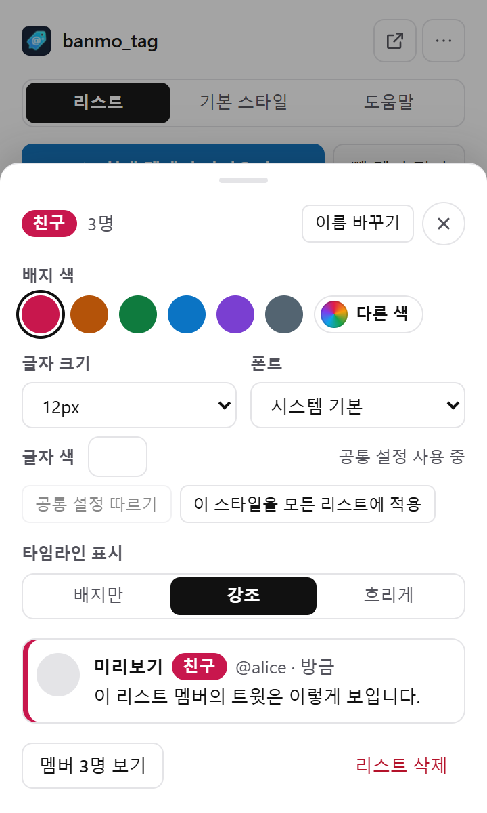
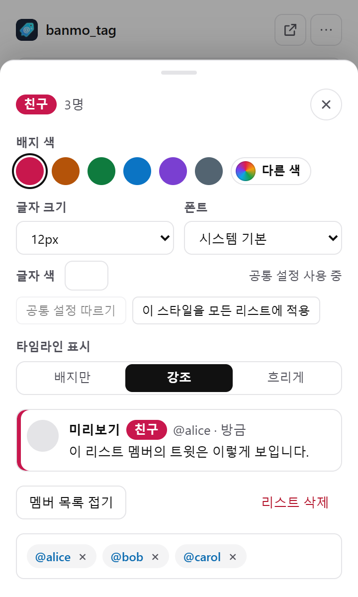
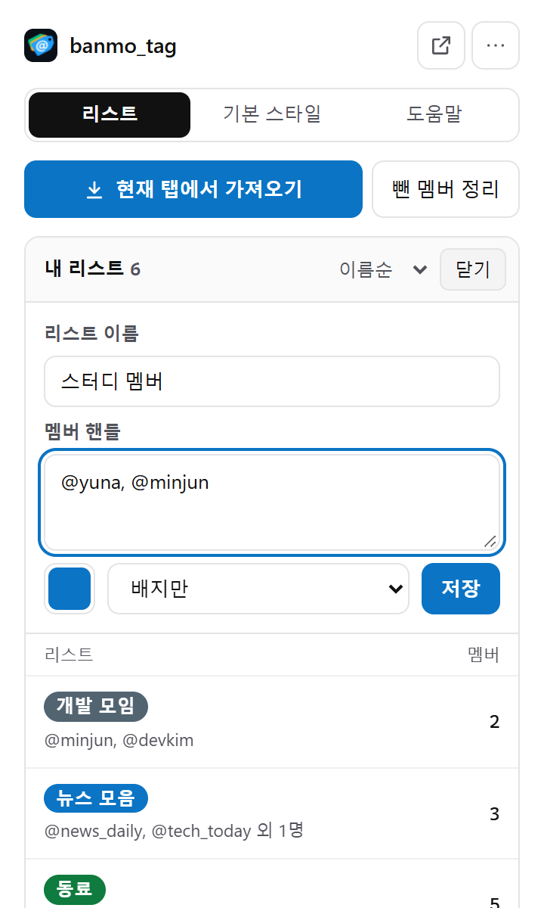
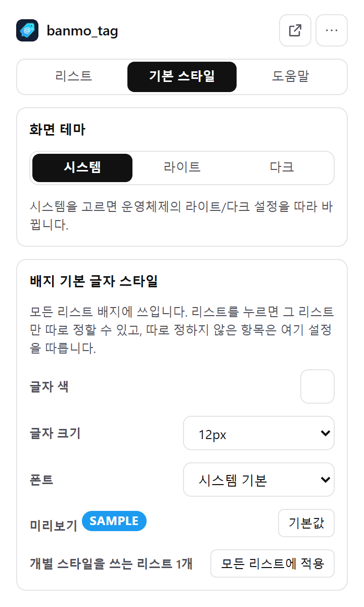
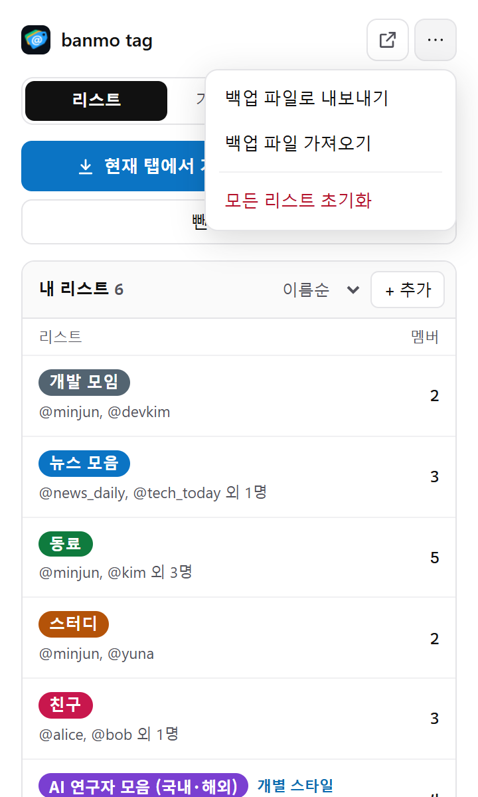

# banmo_tag (Chrome · Firefox Extension)

banmo_tag는 X(Twitter) 타임라인에서 **내가 정한 리스트의 멤버를 한눈에 알아볼 수 있게** 해 주는 브라우저 확장 프로그램입니다. 리스트 멤버가 쓴 트윗의 이름 옆에 리스트 배지를 붙이고, 리스트마다 트윗을 강조하거나 흐리게 표시합니다.

- 지원 브라우저: 크롬과 크롬 계열(엣지, 웨일 등), 파이어폭스 140 이상
- 현재 버전: **v1.9.2** (변경 내역은 [docs/CHANGELOG.md](docs/CHANGELOG.md))
- 모든 데이터는 브라우저(`chrome.storage.local`)에만 저장되며 외부로 전송되지 않습니다. ([개인정보 처리방침](docs/PRIVACY.md))

  

예시 화면입니다. 실제 X 가 아니라 예시 타임라인 페이지에 실제 확장 프로그램을 적용해 찍었습니다.

## 목차

- [설치](#설치)
- [사용법](#사용법)
- [주요 기능 한눈에 보기](#주요-기능-한눈에-보기)
- [자주 묻는 질문](#자주-묻는-질문)
- [개발](#개발)
- [라이선스](#라이선스)

---

## 설치

[Releases](https://github.com/YunjinJo/banmo_tag/releases/latest) 에서 브라우저에 맞는 zip 을 받습니다.

| 파일 | 브라우저 |
|---|---|
| `banmo_tag-vX.Y.Z-chrome.zip` | 크롬, 엣지, 웨일 등 크롬 계열 |
| `banmo_tag-vX.Y.Z-firefox.zip` | 파이어폭스 140 이상 |

### 크롬 (크롬 계열)

1. 받은 `-chrome.zip` 의 압축을 풉니다. **앞으로 지우지 않을 폴더**에 풀어 두세요(예: `문서anmo_tag`).
2. 주소창에 `chrome://extensions` 를 엽니다(엣지는 `edge://extensions`).
3. 오른쪽 위 **개발자 모드**를 켭니다.
4. **압축해제된 확장 프로그램 로드**를 누르고 1번에서 푼 폴더를 고릅니다.
5. 툴바의 퍼즐 아이콘(확장 프로그램)에서 banmo tag 를 **고정**해 두면 팝업을 열기 편합니다.

  

> **업데이트할 때**: 새 zip 을 **같은 폴더에** 덮어써서 풀고, 확장 프로그램 관리 화면에서 banmo tag 의 새로고침(↻)을 누릅니다. 저장된 리스트는 그대로 남습니다. 다른 폴더에서 로드하면 다른 확장 프로그램으로 인식되어 리스트가 보이지 않으니, 그럴 때는 먼저 [백업](#7-백업과-복원)을 해 두세요.

### 파이어폭스 (140 이상)

1. 주소창에 `about:debugging#/runtime/this-firefox` 를 엽니다.
2. **임시 부가 기능 로드…**를 누르고 받은 `-firefox.zip` 파일을 고릅니다.
3. x.com 접근을 묻는 창이 뜨면 허용합니다. (허용하지 않았다면 팝업에 [x.com 접근 허용] 버튼이 나타납니다.)

> 임시로 로드한 부가 기능은 **파이어폭스를 다시 시작하면 사라집니다**. 계속 쓰려면 Mozilla 의 서명을 받아야 합니다(부가 기능 사이트 AMO 에 올려 서명. 목록에 공개하지 않는 "unlisted" 도 가능). 다시 로드하기 전에 리스트를 [백업](#7-백업과-복원)해 두세요.

---

## 사용법

툴바의 banmo tag 아이콘을 누르면 팝업이 열립니다. 팝업은 **[리스트 | 기본 스타일 | 도움말]** 탭으로 나뉩니다. [도움말] 탭에 아래 사용법을 짧게 정리해 두었습니다.

### 1. X 리스트 멤버 가져오기

1. X 에서 내 리스트를 열고 **멤버** 화면(`x.com/i/lists/<ID>/members` 또는 "N 멤버"를 눌러 뜨는 창)을 엽니다.
2. 멤버 화면을 열기만 해도 화면에 보이는 멤버가 **자동으로 저장**됩니다. 스크롤하면 새로 보이는 멤버도 이어서 저장됩니다.
3. 바로 저장하고 싶으면 팝업의 **[현재 탭에서 가져오기]**를 누릅니다. 위쪽에 결과가 표시됩니다.
4. 멤버가 많아 직접 스크롤하기 번거로우면 **[끝까지 스캔]**을 누릅니다. 멤버 화면을 맨 위부터 끝까지 자동으로 스크롤하며 멤버를 모두 읽고, 끝나면 [뺀 멤버 정리]와 같은 확인 창을 띄웁니다([5. 뺀 멤버 정리하기](#5-x-리스트에서-뺀-멤버-정리하기)).
   - 스캔하는 동안 팝업 위쪽에 읽은 멤버 수가 보이고, 버튼은 **[스캔 중지]**로 바뀝니다. X 화면을 직접 스크롤하거나 누르면 멈춥니다.
   - 팝업이 닫혀도 스캔은 X 탭에서 계속되고, 팝업을 다시 열면 진행 상황을 이어서 보여 줍니다. 팝업이 닫힌 사이에 스캔이 끝났다면, 다시 열 때 확인 창이 뜹니다.
   - X 가 멤버를 불러올 때까지 기다리며 내리므로, 멤버가 많으면 몇 분 걸릴 수 있습니다. 스캔 중에는 그 X 탭을 열어 두세요.

  

- 리스트 메인 화면을 먼저 열었다가 멤버 화면으로 가면 리스트 이름이 정확하게 저장됩니다. 이름을 읽지 못하면 임시로 `리스트 (ID)` 로 저장되고, 나중에 실제 이름을 읽으면 자동으로 바뀝니다.
- X 에서 리스트 이름을 바꾸면, 다음에 그 리스트의 멤버를 가져올 때 저장된 이름도 따라 바뀝니다(배지 색과 표시 방식은 그대로). 팝업에서 직접 바꾼 이름은 그대로 둡니다.
- "팔로우 추천", "추천" 탭, 사이드바의 계정은 수집하지 않습니다.

### 2. 타임라인에서 배지 보기

이제 X 타임라인에서 리스트 멤버의 트윗 이름 옆에 리스트 배지가 붙습니다(맨 위 예시 화면).

- 여러 리스트에 속하면 배지가 나란히 붙고, **4개 이상이면 2개 + "+N"** 으로 묶입니다. "+N" 에 마우스를 올리면 모든 리스트 이름이 보입니다.
- 긴 리스트 이름은 "…" 으로 줄어들고, 마우스를 올리면 전체 이름이 보입니다.
- 인용된 트윗의 작성자에게는 작은 배지가 붙습니다.
- 리스트마다 **타임라인 표시**를 고를 수 있습니다:
  - **배지만**: 배지만 붙입니다.
  - **강조**: 트윗 왼쪽에 리스트 색 띠를 둡니다 (예시의 Alice Kim).
  - **흐리게**: 프로필 사진·본문·사진을 흐리게 해서 덜 눈에 띄게 합니다. 이름과 배지는 또렷하게 남습니다 (예시의 Daily News).

### 3. 리스트 관리

**[리스트]** 탭에 저장된 리스트가 표로 보입니다. 리스트마다 배지 모양, 멤버 일부, 멤버 수가 나오고, 이름순 / 멤버 수로 정렬할 수 있습니다. 글자 스타일을 따로 정한 리스트에는 "개별 스타일"이라고 표시됩니다.

<table>
  <tr>
    <td align="center"> 리스트 탭 (라이트)</td>
    <td align="center"> 다크 테마</td>
  </tr>
</table>

리스트 줄을 누르면 아래에서 **리스트 설정 창**이 올라옵니다.

<table>
  <tr>
    <td align="center"> 리스트 설정 창</td>
    <td align="center"> [멤버 N명 보기]</td>
  </tr>
</table>

- **[이름 바꾸기]**: 리스트 이름을 바꿉니다. 배지 색, 표시 방식, 글자 스타일, 멤버는 그대로 유지됩니다. X 에서 가져온 리스트는 직접 바꾼 이름을 계속 쓰고, **[X 이름 따르기]**를 누르면 다음에 멤버를 가져올 때 다시 X 의 리스트 이름으로 바뀝니다.
- **배지 색**: 빠른 선택 6색 중에서 고르거나, **[다른 색]** 을 눌러 원하는 색을 고릅니다.
- **글자 크기 · 폰트 · 글자 색**: 이 리스트 배지만 따로 정합니다. 따로 정하지 않은 항목은 [기본 스타일] 탭의 설정을 따릅니다. [공통 설정 따르기]로 되돌리고, [이 스타일을 모든 리스트에 적용]을 누르면 이 스타일이 공통 설정이 되고 다른 리스트의 개별 스타일은 지워집니다.
- **타임라인 표시**: 배지만 / 강조 / 흐리게. 아래 미리보기에서 바로 확인할 수 있습니다.
- **[멤버 N명 보기]**: 멤버를 보고, 잘못 들어간 멤버는 `×` 로 지웁니다.
- **[리스트 삭제]**: 확인 창에서 한 번 더 확인한 뒤 지웁니다.
- 닫기: `×` 버튼, 바깥 부분 클릭, 또는 Esc.

### 4. 리스트 직접 만들기

X 리스트 없이도 핸들을 직접 입력해 리스트를 만들 수 있습니다. 표 위쪽의 **[+ 추가]**를 누르고, 리스트 이름과 멤버 핸들(쉼표나 줄바꿈으로 구분, `@` 는 빼도 됨), 배지 색, 타임라인 표시를 정한 뒤 **[저장]** 합니다.

  

이미 있는 리스트 이름을 입력하면 그 리스트에 멤버만 더해지고, 색과 표시 방식은 그대로 유지됩니다.

### 5. X 리스트에서 뺀 멤버 정리하기

X 리스트에서 누군가를 뺐다면, 그 리스트의 멤버 화면을 열어 **맨 위부터 끝까지** 보면 저장된 목록에서도 자동으로 지워집니다. 멤버가 적어 한 화면에 다 보이는 리스트는 열기만 하면 됩니다.

자동으로 지우는 것은 목록을 빠짐없이 본 것이 확인될 때뿐입니다. 다음 경우에는 지우지 않습니다.

- 목록을 끝까지 내리지 않았거나, 중간을 빠르게 건너뛰어 내려간 경우 (맨 위로 돌아가 천천히 다시 내리면 됩니다)
- 저장된 멤버의 **절반 넘게** 지워질 상황인 경우 (화면을 잘못 읽었을 때를 대비한 안전장치)
- 팝업의 [+ 추가]로 직접 만든 리스트

팝업의 [+ 추가]로 X 리스트에 직접 더한 멤버는 X 리스트에 없어도 지우지 않습니다.

자동으로 지워지지 않았다면 직접 정리할 수 있습니다.

1. X 에서 그 리스트의 멤버 화면을 열고 **끝까지 스크롤**합니다. 팝업의 **[끝까지 스캔]**을 누르면 자동으로 스크롤하고 2·3번 확인 창까지 띄워 줍니다.
2. 팝업의 **[뺀 멤버 정리]**를 누릅니다.
3. 지워질 멤버를 확인 창에서 보고 **[교체]**를 누릅니다. 이번에 화면에 한 번도 나오지 않은 멤버가 지워집니다.

[끝까지 스캔]으로 읽는 동안과 끝난 뒤에는 자동으로 지우지 않고, 확인 창에서 [교체]를 눌러야 지웁니다.

### 6. 배지 기본 스타일과 화면 테마

**[기본 스타일]** 탭에서 팝업 화면 테마와 모든 배지의 기본 글자 스타일을 정합니다.

  

- **화면 테마**: 시스템(운영체제 설정을 따름) / 라이트 / 다크
- **배지 기본 글자 스타일**: 글자 색, 크기(8–20px), 폰트. 바꾸면 타임라인 배지에 새로고침 없이 바로 반영됩니다. [기본값]으로 되돌립니다.
- **모든 리스트에 적용**: 리스트별로 따로 정한 글자 스타일을 모두 지우고 이 설정으로 통일합니다.

### 7. 백업과 복원

오른쪽 위 **⋯ 메뉴**에서 리스트와 배지 설정을 파일로 백업하고 되살립니다.

  

- **백업 파일로 내보내기**: 리스트(멤버·색·표시 방식·글자 스타일)와 기본 배지 설정을 JSON 파일로 저장합니다.
- **백업 파일 가져오기**: 파일을 고른 뒤 **병합**(파일에만 있는 리스트는 새로 추가하고, 이미 있는 리스트는 색·표시 방식을 그대로 두고 멤버만 더함) 또는 **덮어쓰기**(파일 내용으로 바꿈, 배지 설정도 복원) 중에서 고릅니다.
- **모든 리스트 초기화**: 저장된 리스트를 모두 지웁니다(확인 후).

> 파이어폭스는 팝업에서 파일 선택 창·색상 창을 열면 팝업이 닫혀 버리는 문제가 있어서, 내보내기·가져오기·[다른 색]을 누르면 같은 화면이 **새 탭**에서 열립니다. 팝업 위쪽 [↗] 버튼으로 언제든 새 탭에서 열 수도 있습니다.

---

## 주요 기능 한눈에 보기

| 기능 | 설명 |
|---|---|
| 멤버 자동 수집 | 리스트 멤버 화면을 열면 보이는 멤버를 저장, 스크롤하면 이어서 저장 |
| 즉시 가져오기 | [현재 탭에서 가져오기] |
| 끝까지 스캔 | [끝까지 스캔]: 멤버 화면을 자동으로 맨 위부터 끝까지 스크롤하며 읽고, 끝나면 뺀 멤버 확인 창 |
| 뺀 멤버 정리 | 멤버 화면을 맨 위부터 끝까지 보면 X 리스트에서 뺀 멤버를 자동으로 삭제. 안 되면 [뺀 멤버 정리] (지울 멤버를 먼저 보여 줌) |
| 같은 이름 리스트 구분 | 이름이 같아도 다른 X 리스트면 `친구 (8888)` 처럼 따로 저장 |
| 리스트 이름 바꾸기 | 설정 창의 [이름 바꾸기]. X 에서 바꾼 이름은 다음에 가져올 때 자동으로 반영 |
| 타임라인 배지 | 이름 옆 배지, 4개 이상이면 +N, 긴 이름 말줄임, 인용 트윗 작은 배지 |
| 타임라인 표시 | 리스트별 배지만 / 강조 / 흐리게 |
| 배지 스타일 | 리스트별 배지 색, 글자 색·크기·폰트 (기본값은 [기본 스타일] 탭) |
| 직접 만들기 | 핸들을 입력해 리스트 생성·추가 |
| 백업 | JSON 내보내기, 가져오기(병합 / 덮어쓰기) |
| 화면 테마 | 시스템 / 라이트 / 다크 |
| X 화면 변화 경고 | X 화면 구조가 바뀌어 수집·배지가 멈춘 것으로 보이면 팝업에 경고 |

## 자주 묻는 질문

**배지가 안 보여요.**
- X 탭을 새로고침(F5)해 보세요. 확장 프로그램을 설치하거나 업데이트하기 전에 열려 있던 탭에는 바로 적용되지 않을 수 있습니다.
- 팝업 [리스트] 탭에 그 사람이 들어 있는지 확인하세요(리스트 줄 → [멤버 N명 보기]).
- 팝업 맨 위에 "X 화면 구조가 바뀌었을 수 있습니다" 경고가 있으면, X 가 화면을 바꿔서 확장 프로그램 업데이트가 필요한 상태입니다.

**[현재 탭에서 가져오기]를 눌렀는데 "X(Twitter) 페이지가 아닙니다" 라고 나와요.**
- X 리스트의 **멤버 화면**을 연 탭에서 팝업을 열어야 합니다.

**리스트 이름이 `리스트 (123456)` 처럼 저장됐어요.**
- 이름을 읽지 못해 임시 이름을 쓴 것입니다. 그 리스트의 메인 화면(`x.com/i/lists/<ID>`)을 한 번 열었다가 멤버 화면으로 가면 실제 이름으로 바뀝니다.

**X 에서 리스트 이름을 바꿨는데 팝업에는 옛 이름이 보여요.**
- 그 리스트의 메인 화면을 한 번 열었다가 멤버 화면으로 가면(또는 멤버 화면에서 [현재 탭에서 가져오기]) 새 이름으로 바뀝니다. 팝업에서 직접 바꾼 이름은 바뀌지 않으며, 설정 창의 [이름 바꾸기] → [X 이름 따르기]를 누르면 다시 X 이름을 따라갑니다.

**내 데이터는 어디에 저장되나요?**
- 이 브라우저 안에만 저장되고 어디에도 전송되지 않습니다. 자세한 내용은 [개인정보 처리방침](docs/PRIVACY.md)을 보세요.

---

## 개발

코드를 고치거나 테스트·빌드·릴리스하는 방법은 **[docs/DEVELOPMENT.md](docs/DEVELOPMENT.md)** 에 정리했습니다.

| 문서 | 내용 |
|---|---|
| [docs/DEVELOPMENT.md](docs/DEVELOPMENT.md) | 폴더 구조, 소스 코드로 설치, 개발 환경·명령, 테스트, CI, 릴리스, 빌드 |
| [docs/CHANGELOG.md](docs/CHANGELOG.md) | 버전별 변경 내역 |
| [docs/TEST_CASES.md](docs/TEST_CASES.md) | 자동 테스트 목록과 수동 확인 시나리오 |
| [docs/TEST_RESULTS.md](docs/TEST_RESULTS.md) | 버전별 테스트 결과 |
| [docs/CODE_IMPROVEMENTS.md](docs/CODE_IMPROVEMENTS.md) | 코드 개선 과제와 진행 상태 |
| [docs/TODO.md](docs/TODO.md) | 남은 할 일 (실제 화면 확인, 배포, 코드 개선, 정리) |
| [docs/MOBILE_TODO.md](docs/MOBILE_TODO.md) | 모바일(안드로이드·아이폰) 지원 할 일 목록 |
| [docs/PRIVACY.md](docs/PRIVACY.md) | 개인정보 처리방침 |

---

## 라이선스

[MIT 라이선스](LICENSE)를 따릅니다. 자유롭게 쓰고, 고치고, 다시 배포할 수 있습니다. 다시 배포할 때는 저작권 표시와 라이선스 문구를 함께 넣어야 하며, 보증은 없습니다.

만든 사람: YunjinJo (YURO), X [@YunjinJo98](https://x.com/YunjinJo98)
