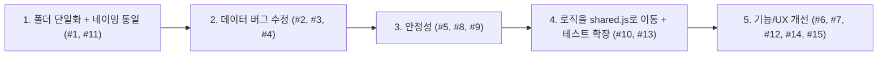

# 🔍 banmo_tag 코드 개선 포인트 (v1.3.0 기준)

> 작성일: 2026-10-19 · 대상: `antigravity-extension/` 전체 (`shared.js`, `content.js`, `popup.js`, `background.js`, `styles.css`, `manifest.json`, 테스트/빌드 스크립트)
>
> 우선순위: 🔴 높음 (버그/데이터 손실 위험) · 🟠 중간 (안정성/유지보수) · 🟢 낮음 (품질/편의)

---

## 진행 상태 (v1.4.1 기준, 2026-11-04)

| # | 상태 | 비고 |
|:-:|:-:|---|
| 1 | ✅ 해결 | 저장소 구성(2026-11-04): 원본은 `extension/` 하나, 루트 복사 단계 삭제 |
| 2, 3, 8, 12, 13 | ✅ 해결 | v1.4.0 |
| 4 | ✅ 해결 | 저장(v1.4.0) + 정제·병합 가져오기(v1.4.1) |
| 5 | ✅ 해결 | v1.4.1: 폴백 제거, 로드 실패 시 명확히 알림 |
| 6 | ⏳ 남음 | 수집 시 삭제 반영(전체 교체 동기화)은 기능 추가가 필요 |
| 7 | ✅ 해결 | v1.4.1: 메인 페이지에서 이름 캐시, 추정 이름은 캐시하지 않음 |
| 9 | 🔶 일부 | v1.4.1: 변경된 트윗만 처리. 리스트 변경 시 전체 다시 그리기는 남음 |
| 10 | 🔶 일부 | `shared.js` 73건. content/popup 흐름은 수동 QA(TC-V141) |
| 11 | ✅ 해결 | 문서·스크립트 정리, 폴더 이름 `extension/`, zip 이름 `banmo_tag-v<버전>.zip` |
| 14 | ✅ 해결 | v1.4.1: 팝업 안 확인 상자 |
| 15 | 🔶 일부 | 버전 검사 완료. 시스템 단어 과차단·i18n·파일 분할은 남음 |

---

## 요약

| # | 우선순위 | 영역 | 내용 |
|:-:|:-:|---|---|
| 1 | 🔴 | 프로젝트 구조 | 루트(`c:\banmo_tag\`)와 `antigravity-extension\`에 같은 파일이 두 벌 있음 |
| 2 | 🔴 | 백업/복원 | 가져오기(Import)할 때 `listId`가 사라짐 |
| 3 | 🔴 | 타임라인 | X가 재사용하는 트윗 DOM에 이전 배지가 그대로 남을 수 있음 |
| 4 | 🔴 | 리스트 병합 | 이름이 같은 서로 다른 리스트가 하나로 합쳐짐 |
| 5 | 🟠 | 팝업 | `shared.js` 폴백 코드가 실제 로드 실패를 가림 |
| 6 | 🟠 | 수집 | 멤버를 추가만 하고 삭제는 반영하지 않음 (Twitter에서 뺀 멤버가 남음) |
| 7 | 🟠 | 리스트 이름 추출 | `getListNameFromPage` 휴리스틱이 엉뚱한 텍스트를 이름으로 잡을 수 있음 |
| 8 | 🟠 | 메시지 통신 | 팝업 ↔ content ↔ background 응답에 타임아웃이 없음 |
| 9 | 🟠 | 성능 | DOM이 바뀔 때마다 전체 트윗 순회 + 수집 시도 |
| 10 | 🟠 | 테스트 | `shared.js` 밖의 로직(content/popup/background)은 검증되지 않음 |
| 11 | 🟢 | 네이밍 | 이름 변경 후에도 `Antigravity` 흔적이 남아 있음 |
| 12 | 🟢 | CSS | 인라인 `!important` 때문에 쓰이지 않는 CSS 규칙이 있음 |
| 13 | 🟢 | 코드 중복 | `debounce` 등 유틸이 여러 파일에 중복됨 |
| 14 | 🟢 | UX | 팝업에서 `alert()`/`confirm()` 네이티브 대화상자를 사용함 |
| 15 | 🟢 | 기타 | 시스템 단어 목록 과차단, 서비스 워커 `setTimeout`, i18n 등 |

---

## 🔴 1. 루트와 하위 폴더에 같은 파일이 두 벌 있음

**현상**
- `c:\banmo_tag\`와 `c:\banmo_tag\antigravity-extension\`에 `manifest.json`, `*.js`, `popup.html`, `icons/` 등이 모두 복제돼 있습니다.
- [`build.ps1`](../scripts/build.ps1)이 매번 하위 폴더 → 루트로 복사(“mirror”)해서 맞추고 있습니다.

**문제**
- Chrome에 어느 폴더를 “압축해제된 확장 프로그램”으로 올렸는지에 따라 실제로 실행되는 코드가 달라집니다. 직전의 `AG_DEFAULT_BADGE_SETTINGS is not defined` 오류도 이렇게 버전이 어긋난 상태에서 생겼을 가능성이 큽니다.
- 루트 파일을 직접 고치면 다음 빌드 때 조용히 덮어써집니다.

**개선안**
- 원본 폴더를 **하나만** 남기세요(예: `extension/` 또는 `src/`). 루트에는 `build.ps1`, `README.md`, 결과물 zip만 둡니다.
- Chrome에는 원본 폴더 하나만 로드하고, 미러 복사 단계(`[2/3] Syncing workspace root mirror files`)는 삭제합니다.

---

## 🔴 2. 가져오기(Import)할 때 `listId`가 사라짐

**위치**: [`normalizeImportedLists`](../extension/shared.js#L310-L323)

```js
result[key] = {
  color: ...,
  mode: ...,
  members: parseHandles(...)
  // ← listId 가 빠짐
};
```

**문제**
- 내보내기(Export)는 `listId`까지 저장하지만, 가져오면 `listId`가 버려집니다.
- 그 결과 [`resolveListKey`](../extension/shared.js#L155-L166)가 같은 리스트를 알아보지 못합니다. 복원한 뒤 다시 수집하면 `리스트 (12345)` 같은 중복 리스트가 생기거나, 이름이 바뀐 리스트가 따로 만들어집니다.

**개선안**
```js
var listId = (val && typeof val.listId === 'string' && /^[A-Za-z0-9_-]+$/.test(val.listId)) ? val.listId : undefined;
result[key] = { color, mode, members, ...(listId ? { listId } : {}) };
```
- 테스트 Suite 10에 “`listId` 보존” 케이스를 추가합니다.

---

## 🔴 3. 재사용되는 트윗 DOM에 이전 배지가 남을 수 있음

**위치**: [`processTimeline`](../extension/content.js#L299-L359)

```js
if (tweet.dataset.agProcessed === 'true') return;
...
tweet.dataset.agProcessed = 'true';
```

**문제**
- X 타임라인은 가상 스크롤이라 `article`/`cellInnerDiv` 노드를 다른 트윗에 재사용할 수 있습니다. 한 번 `agProcessed`가 붙은 노드는 내용이 바뀌어도 다시 처리되지 않습니다.
- 그래서 **다른 사람 트윗에 이전 작성자의 배지·테두리·흐림이 남거나**, 배지가 있어야 할 트윗에 배지가 빠질 수 있습니다.

**개선안**
- 불리언 대신 **처리할 때의 작성자 핸들 목록**을 저장하고, 값이 다르면 초기화한 뒤 다시 처리합니다.
```js
const key = handles.join(',');               // 예: "@a,@b"
if (tweet.dataset.agProcessed === key) return;
resetTweet(tweet);                            // 배지/테두리/opacity 제거
...
tweet.dataset.agProcessed = key;
```

---

## 🔴 4. 이름이 같은 서로 다른 리스트가 하나로 합쳐짐

**위치**: [`background.js` `saveListMembers`](../extension/background.js#L28-L77), [`resolveListKey`](../extension/shared.js#L155-L166)

**문제**
- 저장 키가 **리스트 이름**입니다. 서로 다른 사용자가 만든 `"친구"` 리스트 두 개(서로 다른 `listId`)를 수집하면 같은 키에 멤버가 섞입니다.
- 지금 `resolveListKey`는 `listId`가 같을 때만 따로 처리하고, 이름이 같고 `listId`가 다를 때는 그냥 합칩니다.

**개선안 (둘 중 선택)**
- **A (권장)**: 저장 구조를 `listId` 기준으로 바꿉니다. `{ [listId]: { name, color, mode, members } }`로 두고, 수동으로 추가한 리스트는 `manual-<uuid>` 키를 씁니다. 기존 데이터를 옮기는 마이그레이션 함수가 함께 필요합니다.
- **B (최소 변경)**: 이름이 같은데 `listId`가 다르면 `친구 (2)`처럼 접미사를 붙여 따로 저장합니다.

---

## 🟠 5. 팝업의 `shared.js` 폴백 코드가 실제 로드 실패를 가림

**위치**: [`popup.js` 4–28행](../extension/popup.js#L1-L28), [`content.js` 8–10행](../extension/content.js#L8-L10)

**문제**
- `AG_DEFAULT_BADGE_SETTINGS`만 폴백으로 정의했기 때문에, `shared.js`가 정말 로드되지 않았다면 다음 줄의 `sanitizeListsObject`, `parseHandles` 등에서 결국 다른 `ReferenceError`가 납니다. 원인은 그대로 두고 증상만 옮긴 셈입니다.
- `ensureSharedLoaded()`도 `popup.html`에 `<script src="shared.js">`가 이미 있으므로 실제로는 실행되지 않는 코드입니다.

**개선안**
- 1번(폴더 단일화)을 해결한 뒤 폴백과 `ensureSharedLoaded()`를 삭제합니다.
- 대신 시작 시 한 번 확인하고 실패하면 분명하게 알립니다.
```js
if (typeof sanitizeListsObject !== 'function') {
  document.body.textContent = 'shared.js 로드 실패: 확장 프로그램을 새로고침해주세요.';
  throw new Error('shared.js not loaded');
}
```

---

## 🟠 6. 멤버를 추가만 하고 삭제는 반영하지 않음

**위치**: [`saveListMembers`](../extension/background.js#L63-L76)

**문제**
- 수집할 때 새 멤버를 **합치기만** 합니다. Twitter 리스트에서 뺀 사람은 확장 프로그램에 계속 남아 배지가 붙습니다.
- 지금은 팝업에서 `×`를 눌러 한 명씩 지우는 방법밖에 없습니다.

**개선안**
- 팝업 `[⚡ 가져오기]` 옆에 **“전체 동기화(교체)”** 옵션을 추가합니다. 멤버 화면을 끝까지 스크롤해 모은 목록으로 통째로 바꿉니다.
- 또는 멤버마다 `lastSeenAt`을 기록하고, 오래 보이지 않은 멤버를 팝업에서 “정리 후보”로 보여줍니다.

---

## 🟠 7. 리스트 이름 추출 휴리스틱이 엉뚱한 텍스트를 잡을 수 있음

**위치**: [`getListNameFromPage`](../extension/content.js#L138-L206)

**문제**
- `document.title`을 `' - '`로 자른 뒤 마지막 조각을 쓰기 때문에, 리스트 이름에 `-`가 들어 있으면 이름이 잘립니다(예: `AI - 연구자` → `연구자`).
- TopNavBar 안에서 **처음 나오는 유효한 텍스트**를 쓰므로 표시 이름, 멤버 수 문구 등이 이름으로 잡힐 수 있습니다.
- 한 번 잘못 잡힌 이름은 `sessionStorage` 캐시(`ag_list_name_<id>`)를 통해 멤버 페이지까지 그대로 전달됩니다.

**개선안**
- 우선순위를 **① 리스트 메인 페이지의 헤더(`[data-testid="primaryColumn"] h2`) → ② 캐시 → ③ title**로 바꾸고, title은 `' - '`를 `lastIndexOf` 대신 알려진 접두사(`리스트 멤버`, `List members` 등) 제거 방식으로 처리합니다.
- 확실한 출처(①)에서 얻은 이름만 캐시에 저장합니다.
- 실제 X 페이지의 `document.title`/헤더 HTML 스냅샷을 테스트 fixture로 만들어 회귀 테스트에 추가합니다.

---

## 🟠 8. 메시지 응답 타임아웃이 없음

**위치**: [`sendScrapeRequest`](../extension/popup.js#L105-L112), [`scrapeListMembers`](../extension/content.js#L246-L269)

**문제**
- background 서비스 워커가 처리 중에 종료되거나 응답하지 않으면, 팝업은 `데이터 수집 중...` 상태로 **계속 멈춰 있습니다** (`syncBtn`도 비활성 상태로 남음).

**개선안**
```js
function withTimeout(promise, ms = 8000) {
  return Promise.race([promise, new Promise(r => setTimeout(() => r({ timeout: true }), ms))]);
}
```
- 타임아웃이 나면 “응답이 없습니다. 다시 시도해주세요.”를 보여주고 버튼을 다시 활성화합니다.

---

## 🟠 9. DOM이 바뀔 때마다 전체 순회 + 수집 시도

**위치**: [`debouncedProcess`](../extension/content.js#L373-L381), [`observer`](../extension/content.js#L396-L402)

**문제**
- 모든 페이지(홈, 알림 등)에서 DOM이 바뀔 때마다 `scrapeListMembers(false)`가 실행됩니다. 이 함수는 URL을 확인하기 **전에** `getMemberListDialog()`로 모든 `div[role="dialog"]`를 검색합니다.
- `processTimeline`도 매번 `article[data-testid="tweet"]` 전체를 순회합니다.

**개선안**
- `scrapeListMembers` 맨 앞에서 `parseListUrl`이 `null`이면 즉시 반환하도록 순서를 바꿉니다.
- 처리하지 않은 트윗만 고릅니다. `article[data-testid="tweet"]:not([data-ag-processed])` 또는 `addedNodes`에서 바로 찾습니다.
- 리스트 저장이 일어날 때마다 `clearProcessedStyles()`로 모든 배지를 지우고 다시 그리므로, 바뀐 핸들만 갱신하는 방식(diff)을 검토합니다.

---

## 🟠 10. 테스트가 `shared.js`에만 집중돼 있음

**문제**
- `getListNameFromPage`, `processTimeline`, `saveListMembers`(이름 변경/병합), 팝업의 Merge/Replace 등 **실제 버그가 자주 나는 경로**는 자동 테스트가 없습니다.
- [Suite 6 (`removeMember`)](../tests/test-runner.html)은 실제 코드를 부르지 않고 테스트 안에서 `filter`를 직접 실행하므로 항상 통과합니다(의미 없는 테스트).

**개선안**
- 순수하게 만들 수 있는 로직을 `shared.js`로 옮깁니다:
  - `mergeMembers(existing, incoming)`, `removeMember(lists, name, handle)`
  - `applySaveResult(lists, name, members, listId)` (현재 `saveListMembers`의 데이터 처리 부분)
  - `mergeImport(lists, data)` / `replaceImport(data)`
  - `pickListName(sources)` (이름 추출 우선순위 결정)
- `chrome.storage`를 메모리로 흉내 내는 mock을 만들어 background 저장 흐름을 테스트합니다.

---

## 🟢 11. 이름 변경 후에도 `Antigravity` 흔적이 남아 있음

| 위치 | 현재 |
|---|---|
| 폴더/zip 이름 | `antigravity-extension/`, `antigravity-extension.zip` |
| [`content.js` 420행](../extension/content.js#L420) | `console.log('[Antigravity] Content Script Initialized.')` |
| [`run-tests.ps1`](../tests/run-tests.ps1) | `Antigravity Extension Automated Test Runner` |
| `CHANGELOG.md`, `TEST_CASES.md`, `README.md` | 제목과 본문의 `Antigravity` |

**개선안**: 폴더를 정리할 때(1번) 함께 `banmo_tag`로 통일합니다. 배포 파일은 `banmo_tag-v1.3.0.zip`처럼 버전을 넣어 만듭니다.

---

## 🟢 12. 쓰이지 않는 CSS 규칙

**위치**: [`styles.css`](../extension/styles.css)

- `.ag-list-badge`의 `font-size: 11px !important`, `color: white !important`와 `.mini-badge`의 `font-size: 9px !important`는 [`applyBadgeStyle`](../extension/shared.js#L268-L279)이 인라인 `!important`로 항상 덮어쓰므로 적용되지 않습니다.
- `margin-left`가 `.ag-badges-wrapper`(6px)와 `.mini-badge`(4px)에 겹쳐 있습니다.

**개선안**: CSS 변수로 바꾸면 인라인 `!important` 경쟁이 사라집니다.
```css
.ag-list-badge { font-size: var(--ag-fs, 11px) !important; color: var(--ag-fg, #fff) !important; }
```
```js
badge.style.setProperty('--ag-fs', size + 'px');
badge.style.setProperty('--ag-fg', s.textColor);
```

---

## 🟢 13. 유틸 코드 중복

- `debounce`가 [`content.js`](../extension/content.js#L365-L371)와 [`popup.js`](../extension/popup.js)에 각각 있습니다.
- “소문자 Set으로 중복 제거 후 합치기” 로직이 `background.js`, `popup.js`(수동 추가 / Merge Import), `sanitizeListsObject`에 4번 반복됩니다.
- 핸들 정규식 `/^@[A-Za-z0-9_]{1,15}$/`이 여러 파일에 하드코딩돼 있습니다.

**개선안**: `shared.js`에 `debounce`, `mergeHandles(a, b)`, `AG_HANDLE_RE`를 두고 모든 곳에서 재사용합니다.

---

## 🟢 14. 팝업의 네이티브 대화상자

- `alert()` / `confirm()`은 팝업 UI와 어울리지 않고, 일부 환경에서는 팝업 포커스를 잃게 만듭니다.
- **개선안**: 이미 있는 `#sync-status` 메시지 영역과 `#import-choice` 같은 인라인 확인 UI로 통일합니다(삭제/초기화 확인 포함).

---

## 🟢 15. 기타

- **시스템 단어 과차단**: [`isSystemListName`](../extension/shared.js#L15-L32)에 `X`, `Post`, `Home` 등이 있어서 실제 리스트 이름이 `X`인 경우 등록할 수 없습니다. 자동 수집에서만 막고 수동 추가에서는 허용하는 방안을 검토합니다.
- **서비스 워커 `setTimeout`**: [`showSavedBadge`](../extension/background.js#L16-L26)의 3초 뒤 지우기는 서비스 워커가 먼저 종료되면 실행되지 않습니다. `chrome.alarms`를 쓰거나 팝업을 열 때 지우는 현재 방식에만 의존합니다.
- **i18n**: 문구가 모두 한국어로 하드코딩돼 있습니다. 필요하면 `_locales/ko`, `_locales/en`과 `chrome.i18n.getMessage`로 분리합니다.
- **버전 관리**: `manifest.json`의 `version`과 `CHANGELOG.md` 최신 버전을 `build.ps1`에서 비교해 다르면 빌드를 실패시킵니다.
- **팝업 파일 크기**: `popup.js`가 560줄 이상입니다. 팝업은 ES Module(`<script type="module">`)을 쓸 수 있으므로 `storage.js` / `render.js` / `import-export.js` / `badge-settings.js`로 나눌 수 있습니다.

---

## 권장 진행 순서



> [!IMPORTANT]
> 4번(리스트 저장 키를 `listId` 기준으로 바꾸기)은 저장 데이터 구조가 바뀌므로 **마이그레이션 함수와 테스트를 먼저** 작성한 뒤 진행해야 기존 사용자 데이터를 잃지 않습니다.
